# Lab16：图——408 历年真题分类练习

> **作业目标**：通过 33 道 408 历年真题（2009–2026）选择题，按题型系统巩固图一章的核心内容：图的基本概念与性质、图的存储结构、图的遍历、最小生成树、最短路径、拓扑排序与有向无环图、关键路径。请先独立作答，再对照课程统一发布的答案与解析核对订正；涉及遍历序列的题目，建议先写出每个顶点的邻接点，再按算法规则逐步模拟；涉及 AOE 网的题目，建议先求各顶点的最早发生时间与最迟发生时间，再计算时间余量。
>
> 本次为纯书面作业，不要求编写程序、不要求截图。全卷按题型分组，不按年份排列，题号后的括号内仍标注真题年份，便于对照复习。
>
> **审核说明**：本次 PR 自动审核会检查 `Lab16.md` 与题图文件是否存在、题图是否被改动，以及每道选择题是否恰好勾选一个选项。自动审核不判断所选选项是否正确，内容正确性将在期末统一检测。空文件、未作答的模板或删改题目、选项的文件不能通过本次审核。

---

## 一、作答说明

1. 全卷共 33 道单项选择题，按题型分为七组，分组与题号如下：

   | 组别 | 题型 | 题号 | 题数 |
   | :--- | :--- | :--- | :---: |
   | 第一组 | 图的基本概念与性质 | 题 1～7 | 7 |
   | 第二组 | 图的存储结构 | 题 8～10 | 3 |
   | 第三组 | 图的遍历 | 题 11～14 | 4 |
   | 第四组 | 最小生成树 | 题 15～17 | 3 |
   | 第五组 | 最短路径 | 题 18～21 | 4 |
   | 第六组 | 拓扑排序与有向无环图 | 题 22～29 | 8 |
   | 第七组 | 关键路径与 AOE 网 | 题 30～33 | 4 |

2. 作答时将所选选项前的 `[ ]` 改为 `[x]`，每题只能勾选一项；不要删除其他选项，不要改动题面、选项顺序和题图。
3. 答案与解析不在本文件中，由课程统一发布；先独立完成，再核对订正。
4. 判断遍历序列时，先写出每个顶点的邻接点，再按深度优先用栈、广度优先用队列的规则逐步展开；不要只凭印象选择。
5. 涉及最小生成树、最短路径与关键路径的题目，建议把每轮选中的边、`dist` 数组的变化，或各顶点的最早发生时间与最迟发生时间列成表格，再与选项核对。
6. 本次不涉及编程、不涉及截图，也不需要运行任何程序。

---

## 二、图的基本概念与性质（题 1～7）

### 题 1（2009 年）

下列关于无向连通图特性的叙述中，正确的是（ ）。

I. 所有顶点的度之和为偶数
II. 边数大于顶点个数减 1
III. 至少有一个顶点的度为 1

- [x] A. 只有 I
- [ ] B. 只有 II
- [ ] C. I 和 II
- [ ] D. I 和 III

### 题 2（2010 年）

若无向图 G=(V,E) 中含有 7 个顶点，要保证图 G 在任何情况下都是连通的，则需要的边数最少是（ ）。

- [ ] A. 6
- [ ] B. 15
- [x] C. 16
- [ ] D. 21

### 题 3（2011 年）

下列关于图的叙述中，正确的是（ ）。

I. 回路是简单路径
II. 存储稀疏图，用邻接矩阵比邻接表更省空间
III. 若有向图中存在拓扑序列，则该图不存在回路

- [ ] A. 仅 II
- [ ] B. 仅 I、II
- [x] C. 仅 III
- [ ] D. 仅 I、III

### 题 4（2017 年）

已知无向图 G 含有 16 条边，其中度为 4 的顶点个数为 3，度为 3 的顶点个数为 4，其他顶点的度均小于 3。图 G 所含的顶点个数至少是（ ）。

- [ ] A. 10
- [x] B. 11
- [ ] C. 13
- [ ] D. 15

### 题 5（2022 年）

对于无向图 G=(V,E)，下列选项中，正确的是（ ）。

- [ ] A. 当 |V| > |E| 时，G 一定是连通的
- [ ] B. 当 |V| < |E| 时，G 一定是连通的
- [ ] C. 当 |V| = |E|-1 时，G 一定是不连通的
- [x] D. 当 |V| > |E|+1 时，G 一定是不连通的

### 题 6（2025 年）

下列关于图的叙述中，正确的是（ ）。

- [ ] A. 有向图必定存在入度为 0 的顶点
- [ ] B. 有向无环图的拓扑有序序列存在且唯一
- [x] C. 各顶点的度均大于等于 2 的无向图必有回路
- [ ] D. 可用 BFS 算法求出带权图中的每一对顶点的最短路径

### 题 7（2026 年）

设有向图 G=(V,E)，其中顶点集 V 的大小为 n=|V|，每条边 e∈E 都标记有一个字符（不同边可标记相同字符）。定义字符串集 S 为：所有由 G 中任意一条路径（路径可包含单个顶点，对应空字符串）上的边标记按顺序拼接而成的字符串的集合。以下说法错误的是（ ）。

- [ ] A. 若 G 无环，则 S 是有限集
- [x] B. 若 G 无环，则 S 中存在长度为 n 的字符串
- [ ] C. 若 G 有环，则 S 中存在长度大于 n 的字符串
- [ ] D. 若 G 有环，则 S 中存在长度小于 2n 的字符串

---

## 三、图的存储结构（题 8～10）

### 题 8（2013 年）

设图的邻接矩阵 A 如下所示。各顶点的度依次是（ ）。

```text
A =
[ 0  1  0  1 ]
[ 0  0  1  1 ]
[ 0  1  0  0 ]
[ 1  0  0  0 ]
```

- [ ] A. 1，2，1，2
- [ ] B. 2，2，1，1
- [x] C. 3，4，2，3
- [ ] D. 4，4，2，2

### 题 9（2024 年）

给定无向图的邻接多重表，求顶点 b、d 的度（ ）。

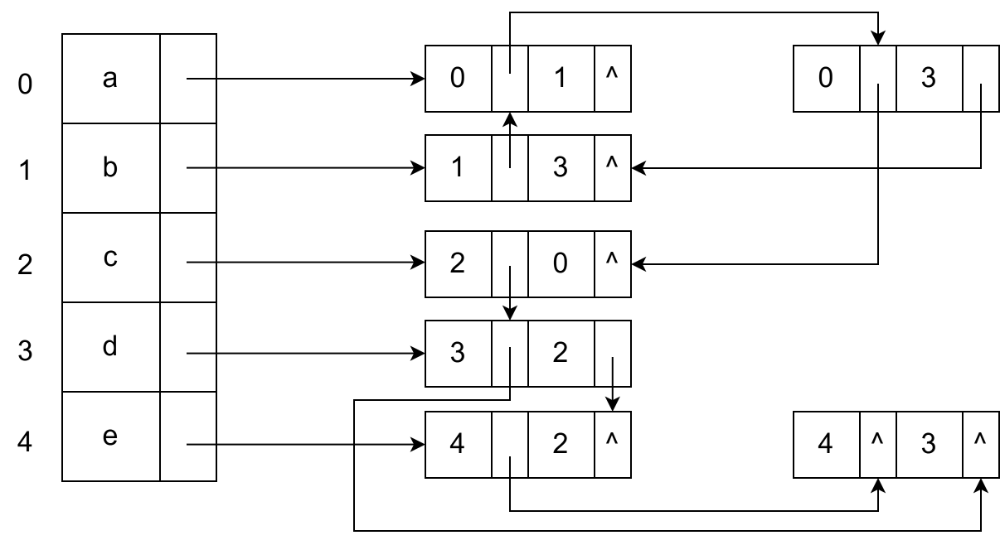

- [ ] A. 0, 2
- [x] B. 2, 4
- [ ] C. 3, 2
- [ ] D. 2, 3

### 题 10（2026 年）

有向图 G=(V,E) 采用邻接表存储，求某点入度的时间复杂度为（ ）。

- [ ] A. O(|V|)
- [ ] B. O(min(|V|,|E|))
- [x] C. O(|E|)
- [ ] D. O(max(|V|,|E|))

---

## 四、图的遍历（题 11～14）

### 题 11（2012 年）

对有 n 个结点、e 条边且使用邻接表存储的有向图进行广度优先遍历，其算法时间复杂度是（ ）。

- [ ] A. O(n)
- [ ] B. O(e)
- [x] C. O(n+e)
- [ ] D. O(n×e)

### 题 12（2013 年）

若对如下无向图进行遍历，则下列选项中，不是广度优先遍历序列的是（ ）。

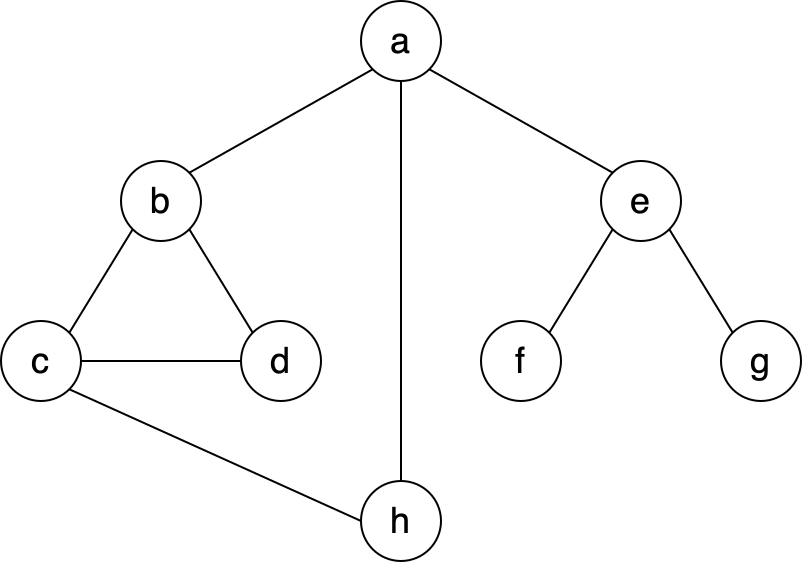

- [ ] A. h，c，a，b，d，e，g，f
- [ ] B. e，a，f，g，b，h，c，d
- [ ] C. d，b，c，a，h，e，f，g
- [x] D. a，b，c，d，h，e，f，g

### 题 13（2015 年）

设有向图 G=(V,E)，顶点集 V={v₀, v₁, v₂, v₃}，边集 E={<v₀, v₁>，<v₀, v₂>，<v₀, v₃>，<v₁, v₃>}。若从顶点 v₀ 开始对图进行深度优先遍历，则可能得到的不同遍历序列个数是（ ）。

- [ ] A. 2
- [ ] B. 3
- [ ] C. 4
- [x] D. 5

### 题 14（2016 年）

下列选项中，不是下图深度优先搜索序列的是（ ）。

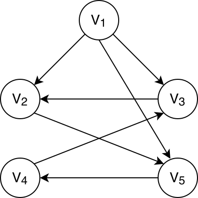

- [ ] A. V₁,V₅,V₄,V₃,V₂
- [ ] B. V₁,V₃,V₂,V₅,V₄
- [ ] C. V₁,V₂,V₅,V₄,V₃
- [x] D. V₁,V₂,V₃,V₄,V₅

---

## 五、最小生成树（题 15～17）

### 题 15（2012 年）

下列关于最小生成树的叙述中，正确的是（ ）。

I. 最小生成树的代价唯一
II. 所有权值最小的边一定会出现在所有的最小生成树中
III. 使用普里姆（Prim）算法从不同顶点开始得到的最小生成树一定相同
IV. 使用普里姆算法和克鲁斯卡尔（Kruskal）算法得到的最小生成树总不相同

- [x] A. 仅 I
- [ ] B. 仅 II
- [ ] C. 仅 I、III
- [ ] D. 仅 II、IV

### 题 16（2015 年）

求下面带权图的最小（代价）生成树时，可能是克鲁斯卡尔（Kruskal）算法第 2 次选中但不是普里姆（Prim）算法（从 V₄ 开始）第 2 次选中的边是（ ）。

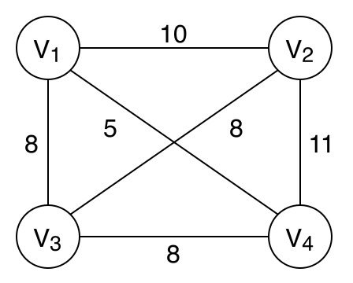

- [ ] A. (V₁, V₃)
- [ ] B. (V₁, V₄)
- [x] C. (V₂, V₃)
- [ ] D. (V₃, V₄)

### 题 17（2020 年）

已知无向图 G 如下所示，使用克鲁斯卡尔（Kruskal）算法求图 G 的最小生成树，加入到最小生成树中的边依次是（ ）。

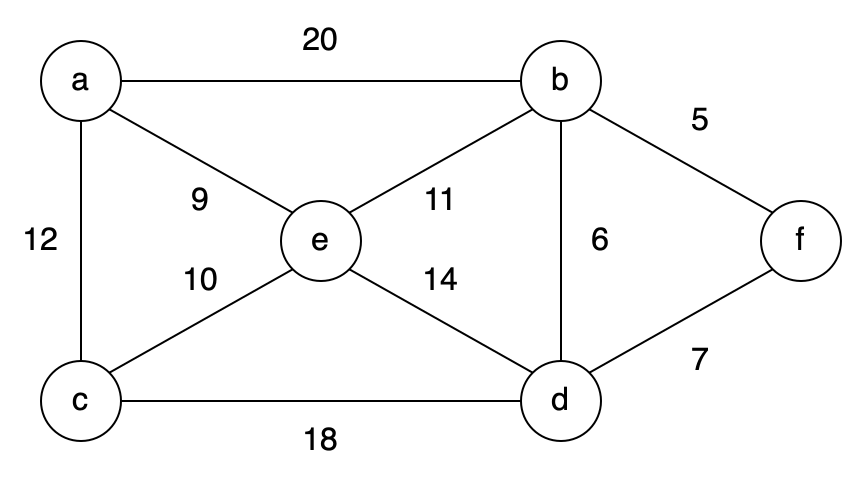

- [x] A. (b,f)(b,d)(a,e)(c,e)(b,e)
- [ ] B. (b,f)(b,d)(b,e)(a,e)(e,c)
- [ ] C. (a,e)(b,e)(c,e)(b,d)(b,f)
- [ ] D. (a,e)(c,e)(b,e)(b,f)(b,d)

---

## 六、最短路径（题 18～21）

### 题 18（2012 年）

对如下有向带权图，若采用迪杰斯特拉（Dijkstra）算法求从源点 a 到其他各顶点的最短路径，则得到的第一条最短路径的目标顶点是 b，第二条最短路径的目标顶点是 c，后续得到的其余最短路径的目标顶点依次是（ ）。

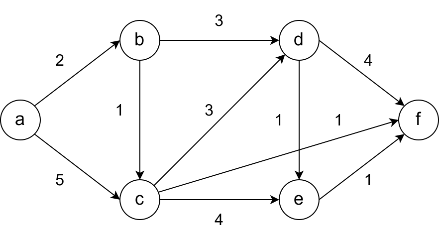

- [ ] A. d, e, f
- [ ] B. e, d, f
- [x] C. f, d, e
- [ ] D. f, e, d

### 题 19（2016 年）

使用迪杰斯特拉（Dijkstra）算法求下图中从顶点 1 到其他各顶点的最短路径，依次得到的各最短路径的目标顶点是（ ）。

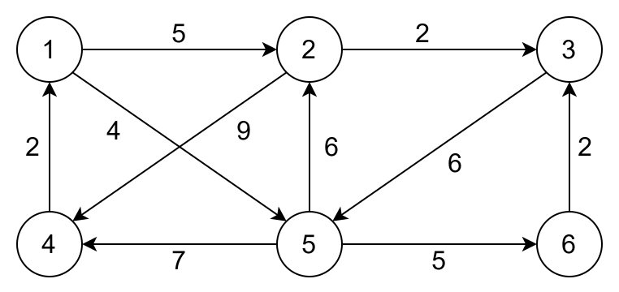

- [ ] A. 5,2,3,4,6
- [x] B. 5,2,3,6,4
- [ ] C. 5,2,4,3,6
- [ ] D. 5,2,6,3,4

### 题 20（2021 年）

使用 Dijkstra 算法求下图中从顶点 1 到其余各顶点的最短路径，将当前找到的从顶点 1 到顶点 2、3、4、5 的最短路径长度保存在数组 dist 中，求出第二条最短路径后，dist 中的内容更新为（ ）。

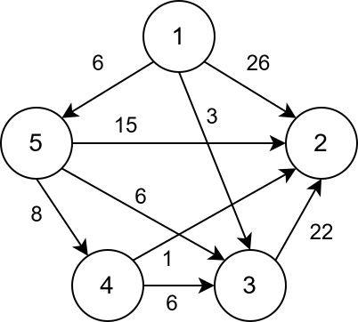

- [ ] A. 26, 3, 14, 6
- [ ] B. 25, 3, 14, 6
- [x] C. 21, 3, 14, 6
- [ ] D. 15, 3, 14, 6

### 题 21（2023 年）

已知无向连通图 G 中各边的权值均为 1，下列算法中，一定能够求出图 G 中从某顶点到其余各个顶点最短路径的是（ ）。

I. 普里姆（Prim）算法
II. 克鲁斯卡尔（Kruskal）算法
III. 图的广度优先搜索

- [ ] A. 仅 I
- [x] B. 仅 III
- [ ] C. 仅 I 和 II
- [ ] D. I、II、III

---

## 七、拓扑排序与有向无环图（题 22～29）

### 题 22（2010 年）

对下图进行拓扑排序，可以得到不同拓扑序列的个数是（ ）。

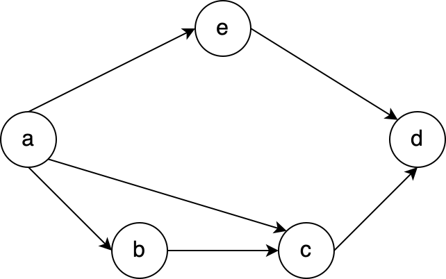

- [ ] A. 4
- [x] B. 3
- [ ] C. 2
- [ ] D. 1

### 题 23（2012 年）

若用邻接矩阵存储有向图，矩阵中主对角线以下的元素均为零，则关于该图拓扑序列的结论是（ ）。

- [ ] A. 存在，且唯一
- [ ] B. 存在，且不唯一
- [x] C. 存在，可能不唯一
- [ ] D. 无法确定是否存在

### 题 24（2014 年）

对如下所示的有向图进行拓扑排序，得到的拓扑序列可能是（ ）。

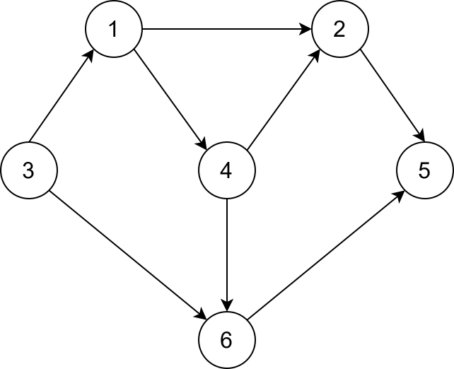

- [ ] A. 3,1,2,4,5,6
- [ ] B. 3,1,2,4,6,5
- [ ] C. 3,1,4,2,5,6
- [x] D. 3,1,4,2,6,5

### 题 25（2016 年）

若将 n 个顶点 e 条弧的有向图采用邻接表存储，则拓扑排序算法的时间复杂度是（ ）。

- [ ] A. O(n)
- [x] B. O(n+e)
- [ ] C. O(n²)
- [ ] D. O(n×e)

### 题 26（2018 年）

下列选项中，不是如下有向图的拓扑序列的是（ ）。

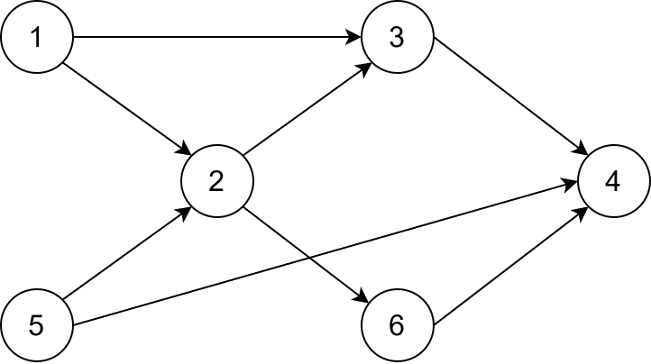

- [ ] A. 1, 5, 2, 3, 6, 4
- [ ] B. 5, 1, 2, 6, 3, 4
- [ ] C. 5, 1, 2, 3, 6, 4
- [x] D. 5, 2, 1, 6, 3, 4

### 题 27（2019 年）

用有向无环图描述表达式 (x+y)*((x+y)/x)，需要的顶点个数至少是（ ）。

- [x] A. 5
- [ ] B. 6
- [ ] C. 8
- [ ] D. 9

### 题 28（2020 年）

修改递归方式实现的图的深度优先搜索（DFS）算法，将输出（访问）顶点信息的语句移到退出递归前（即执行输出语句后立刻退出递归）。采用修改后的算法遍历有向无环图 G，若输出结果中包含 G 中的全部顶点，则输出的顶点序列是 G 的（ ）。

- [ ] A. 拓扑有序序列
- [x] B. 逆拓扑有序序列
- [ ] C. 广度优先搜索序列
- [ ] D. 深度优先搜索序列

### 题 29（2021 年）

给定如下有向图，该图的拓扑有序序列的个数是（ ）。

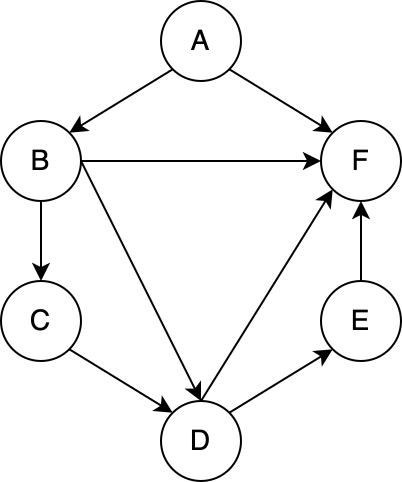

- [x] A. 1
- [ ] B. 2
- [ ] C. 3
- [ ] D. 4

---

## 八、关键路径与 AOE 网（题 30～33）

### 题 30（2013 年）

下列 AOE 网表示一项包含 8 个活动的工程。通过同时加快若干活动的进度可以缩短整个工程的工期。下列选项中，加快其进度就可以缩短工程工期的是（ ）。

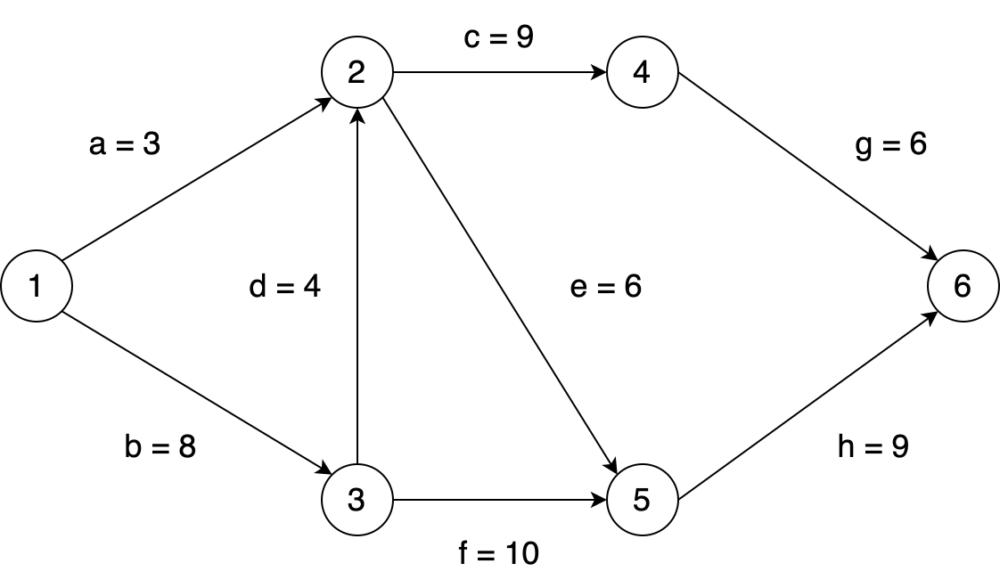

- [ ] A. c 和 e
- [ ] B. d 和 e
- [x] C. f 和 d
- [ ] D. f 和 h

### 题 31（2019 年）

下图所示的 AOE 网表示一项包含 8 个活动的工程。活动 d 的最早开始时间和最迟开始时间分别是（ ）。

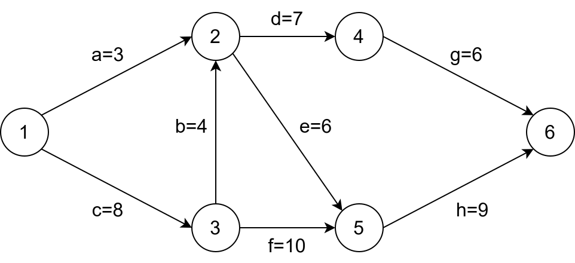

- [ ] A. 3 和 7
- [ ] B. 12 和 12
- [x] C. 12 和 14
- [ ] D. 15 和 15

### 题 32（2020 年）

若使用 AOE 网估算工程进度，则下列叙述中正确的是（ ）。

- [ ] A. 关键路径是从原点到汇点边数最多的一条路径
- [x] B. 关键路径是从原点到汇点路径长度最长的路径
- [ ] C. 增加任一关键活动的时间不会延长工程的工期
- [ ] D. 缩短任一关键活动的时间将会缩短工程的工期

### 题 33（2022 年）

下图是一个有 10 个活动的 AOE 网，时间余量最大的活动是（ ）。

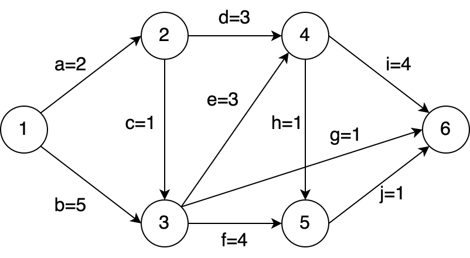

- [ ] A. c
- [x] B. g
- [ ] C. h
- [ ] D. j

---

## 九、提交要求

将本文件复制到自己的 `学号姓名/Lab16/Lab16.md`，完成全部选择题作答。最终只提交以下文件：

```text
学号姓名/
└── Lab16/
    ├── Lab16.md
    └── imgs/
        ├── 2024_q4_stem1.png
        ├── 2013_q8_stem1.png
        ├── 2016_q6_stem1.png
        ├── 2015_q6_stem1.png
        ├── 2020_q7_stem1.png
        ├── 2012_q7_stem1.png
        ├── 2016_q8_stem1.png
        ├── 2021_q8_stem1.png
        ├── 2010_q8_stem1.png
        ├── 2014_q7_stem1.png
        ├── 2018_q7_stem1.png
        ├── 2021_q7_stem1.png
        ├── 2013_q9_stem1.png
        ├── 2019_q5_stem1.png
        └── 2022_q7_stem1.png
```

- `imgs/` 中共有 15 张题图，按上面的顺序分别对应题 9、题 12、题 14、题 16、题 17、题 18、题 19、题 20、题 22、题 24、题 26、题 29、题 30、题 31、题 33，须从 `homework/Lab16/imgs/` 原样复制，不得修改、重命名或替换；缺少任一题图文件，或改动 `Lab16.md` 中的图片引用路径，均判为不完整。
- 每道单项选择题必须且只能将一个选项的 `[ ]` 改为 `[x]`，全卷恰好 33 处 `[x]`；不能全部不选，也不能同时选择多项。
- `Lab16.md` 必须保留全部 33 道题目与全部选项（共 132 个选项），不要改动题面、选项顺序和题图引用路径。
- 答案与解析由课程统一发布，提交的文件中不要自行添加答案、答案速查表或解析。
- 不需要提交程序、截图、`CMakeLists.txt`、`cmake-build-*`、`.idea/`、`.exe` 或其他编译产物。
- `Lab16`、`Lab16.md` 的大小写必须完全一致。
- PR 标题必须严格使用 `[学号姓名]Lab16作业提交`，右方括号后不能有空格。
- 一个 PR 只能包含本次 Lab16 的文件，不得修改其他同学、`homework/`、README 或仓库配置。

---

## 十、截止时间

**2026 年 11 月 6 日 24:00（即 2026 年 11 月 7 日 00:00，北京时间）**

以 GitHub 记录的最后一次向 PR 推送代码的时间为准。不晚于上述时刻创建 PR 并完成最后一次推送不算超时；超过该时刻新建 PR，或向已有 PR 推送任何修改，均算作超时。审核未通过的同学请在截止前完成修改。
