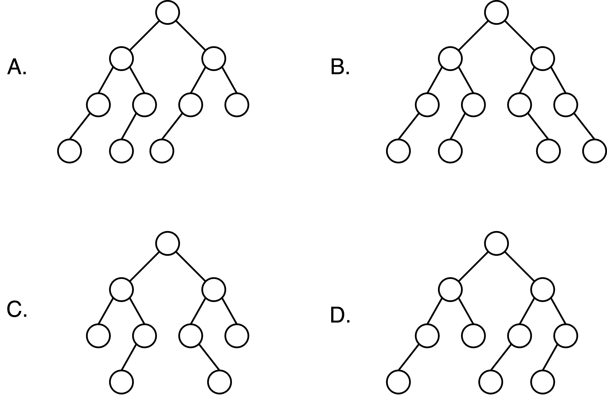

# Lab18：查找——408 历年真题分类练习

> **作业目标**：通过 7 道 408 历年真题（2010–2025）选择题，按题型巩固查找一章的四个知识点：查找的基本概念、顺序查找、折半查找、分块查找。请先独立作答，再对照课程统一发布的答案与解析核对订正；折半查找的题目建议先画出判定树或写出剩余区间，分块查找的题目建议把"确定块"与"块内查找"两段比较次数分别算出再相加。
>
> 本次为纯书面作业，不要求编写程序、不要求截图。全卷按题型分组，不按年份排列，题号后的括号内仍标注真题年份，便于对照复习。二叉排序树、平衡二叉树、B 树、B+ 树与散列表不在本次范围内，另作安排。
>
> **审核说明**：本次 PR 自动审核会检查 `Lab18.md` 与题图文件是否存在、题图是否被改动，以及每道选择题是否恰好勾选一个选项。自动审核不判断所选选项是否正确，内容正确性将在期末统一检测。空文件、未作答的模板或删改题目、选项的文件不能通过本次审核。

---

## 一、作答说明

1. 全卷共 7 道单项选择题，按题型分为三组，分组与题号如下：

   | 组别 | 题型 | 题号 | 题数 |
   | :--- | :--- | :--- | :---: |
   | 第一组 | 查找的基本概念与顺序查找 | 题 1 | 1 |
   | 第二组 | 折半查找 | 题 2～6 | 5 |
   | 第三组 | 分块查找 | 题 7 | 1 |

2. 作答时将所选选项前的 `[ ]` 改为 `[x]`，每题只能勾选一项；不要删除其他选项，不要改动题面、选项顺序和题图。
3. 答案与解析不在本文件中，由课程统一发布；先独立完成，再核对订正。
4. 折半查找的题目建议按比较顺序写出剩余区间：每比较一次，新区间取左半段还是右半段，直接决定下一个被比较的关键字。判定树的题目先数左右子树的结点个数，检查同一棵树内的取整方式是否一致。
5. 分块查找的题目按两段计算：先在索引表中顺序查找确定块，再在块内顺序查找。两段的平均比较次数相加后，再对块长求使总和最小的取值。
6. 本次不涉及编程、不涉及截图，也不需要运行任何程序。

---

## 二、查找的基本概念与顺序查找（题 1）

### 题 1（2016 年）

在有 n(n>1000) 个元素的升序数组 A 中查找关键字 x。查找算法的伪代码如下所示。

```text
k = 0;
while (k < n 且 A[k] < x) k = k + 3;
if (k < n 且 A[k] == x) 查找成功；
else if (k - 1 < n 且 A[k - 1] == x) 查找成功；
else if (k - 2 < n 且 A[k - 2] == x) 查找成功；
else 查找失败；
```

本算法与折半查找算法相比，有可能具有更少比较次数的情形是（）

- [ ] A. 当 x 不在数组中
- [x] B. 当 x 接近数组开头处
- [ ] C. 当 x 接近数组结尾处
- [ ] D. 当 x 位于数组中间位置

---

## 三、折半查找（题 2～6）

### 题 2（2010 年）

已知一个长度为 16 的顺序表 L，其元素按关键字有序排列。若采用折半查找法查找一个 L 中不存在的元素，则关键字的比较次数最多是（ ）。

- [ ] A. 4
- [x] B. 5
- [ ] C. 6
- [ ] D. 7

### 题 3（2015 年）

下列选项中，不能构成折半查找中关键字比较序列的是（）。

- [x] A. 500,200,450,180
- [ ] B. 500,450,200,180
- [ ] C. 180,500,200,450
- [ ] D. 180,200,500,450

### 题 4（2017 年）

下列二叉树中，可能成为折半查找判定树（不含外部结点）的是（）



- [x] A.
- [ ] B.
- [ ] C.
- [ ] D.

### 题 5（2023 年）

对含有 600 个元素的有序顺序表进行折半查找，关键字之间的比较次数最多是（ ）。

- [ ] A. 9
- [x] B. 10
- [ ] C. 30
- [ ] D. 300

### 题 6（2024 年）

下列数据结构中，不适合直接使用折半查找的是（）    I 有序链表 II 无序数组 III 有序静态链表 IV 无序静态链表

- [ ] A. 仅 I、II
- [ ] B. 仅 II、IV
- [x] C. 仅 I、II、IV
- [ ] D. I、II、III、IV

---

## 四、分块查找（题 7）

### 题 7（2025 年）

已知查找表中有 400 个元素，查找元素概率相同。采用分块查找法且均匀分块。若采用顺序查找法确定元素所在块，且块内也采用顺序查找法，为效率最高，每块包含元素应为（ ）。

- [ ] A. 8
- [ ] B. 10
- [x] C. 20
- [ ] D. 25

---

## 五、提交要求

将本文件复制到自己的 `学号姓名/Lab18/Lab18.md`，完成全部选择题作答。最终只提交以下文件：

```text
学号姓名/
└── Lab18/
    ├── Lab18.md
    └── imgs/
        └── 2017_q8_stem1.png
```

- `imgs/` 中只有 1 张题图，对应题 4，须从 `homework/Lab18/imgs/` 原样复制，不得修改、重命名或替换；缺少该题图文件，或改动 `Lab18.md` 中的图片引用路径，均判为不完整。
- 每道单项选择题必须且只能将一个选项的 `[ ]` 改为 `[x]`，全卷恰好 7 处 `[x]`；不能全部不选，也不能同时选择多项。
- `Lab18.md` 必须保留全部 7 道题目与全部选项（共 28 个选项），不要改动题面、选项顺序和题图引用路径。题 4 的四个选项只有标号、没有文字，对应的四棵二叉树在题图中，作答时勾选标号即可。
- 答案与解析由课程统一发布，提交的文件中不要自行添加答案、答案速查表或解析。
- 不需要提交程序、截图、`CMakeLists.txt`、`cmake-build-*`、`.idea/`、`.exe` 或其他编译产物。
- `Lab18`、`Lab18.md` 的大小写必须完全一致。
- PR 标题必须严格使用 `[学号姓名]Lab18作业提交`，右方括号后不能有空格。
- 一个 PR 只能包含本次 Lab18 的文件，不得修改其他同学、`homework/`、README 或仓库配置。

---

## 六、截止时间

**2026 年 11 月 23 日 24:00（即 2026 年 11 月 24 日 00:00，北京时间）**

以 GitHub 记录的最后一次向 PR 推送代码的时间为准。不晚于上述时刻创建 PR 并完成最后一次推送，按按时提交计分。

本次作业满分 10 分，自本次起启用分段迟交计分：

| 迟交时长 | 计分比例 | 得分上限 |
| :--- | :---: | :---: |
| 按时 | 100% | 10.00 |
| 48 小时以内 | 90% | 9.00 |
| 7 天以内 | 75% | 7.50 |
| 14 天以内 | 60% | 6.00 |
| 28 天以内 | 40% | 4.00 |
| 超过 28 天 | 20% | 2.00 |

迟交的 PR 照常审核并合并，不因迟交关闭；题目内容不合规时按审核意见修改即可，修改不再额外降低计分比例。截止前已经推送过实质内容、并在截止后 48 小时内把问题改到审核通过的同学，仍按按时提交计分。分段计分只影响成绩上限，不改变审核标准。
