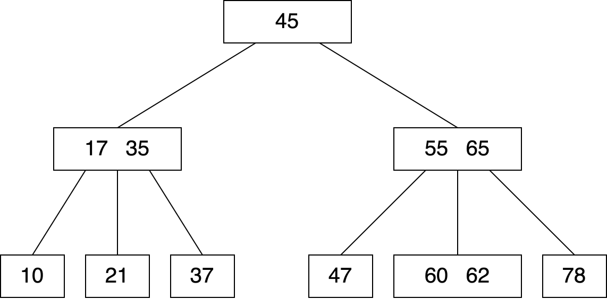
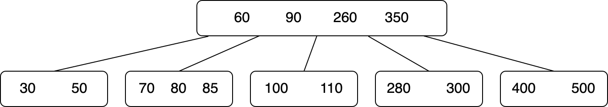

# Lab19：B 树——408 历年真题分类练习

> **作业目标**：通过 10 道 408 历年真题（2009–2025）选择题，按题型巩固查找一章中 B 树的四个知识点：基本概念与性质、高度与关键字数、插入与分裂、删除与调整。请先独立作答，再对照课程统一发布的答案与解析核对订正；算数量关系的题目建议先在草稿上写出阶数决定的取值范围，再按题目要的极端取值；插入与删除的题目建议每做一步就重画一次树，把分裂、借位、合并的动作标在发生变化的结点旁。
>
> 本次为纯书面作业，不要求编写程序、不要求截图。全卷按题型分组，不按年份排列，题号后的括号内仍标注真题年份，便于对照复习。顺序查找、折半查找与分块查找已在 Lab18 练过；散列表、二叉排序树与平衡二叉树另行安排，本次只做 B 树。
>
> **审核说明**：本次 PR 自动审核会检查 `Lab19.md` 与题图文件是否存在、题图是否被改动，以及每道选择题是否恰好勾选一个选项。自动审核不判断所选选项是否正确，内容正确性将在期末统一检测。空文件、未作答的模板或删改题目、选项的文件不能通过本次审核。

---

## 一、作答说明

1. 全卷共 10 道单项选择题，按题型分为四组，分组与题号如下：

   | 组别 | 题型 | 题号 | 题数 |
   | :--- | :--- | :--- | :---: |
   | 第一组 | 基本概念与性质 | 题 1～2 | 2 |
   | 第二组 | 高度、关键字数与结点数 | 题 3～7 | 5 |
   | 第三组 | 插入与分裂 | 题 8 | 1 |
   | 第四组 | 删除与调整 | 题 9～10 | 2 |

2. 作答时将所选选项前的 `[ ]` 改为 `[x]`，每题只能勾选一项；不要删除其他选项，不要改动题面、选项顺序和题图。
3. 答案与解析不在本文件中，由课程统一发布；先独立完成，再核对订正。
4. B 树的概念题把四个选项逐个对照定义核对，看清每个选项对应的是哪一条要求。
5. 涉及数量关系的题目先确定阶数 m 给每个结点带来的关键字个数取值范围，再分清题目要的是"关键字最少""关键字最多"还是"结点最多"；算完再核对树的层数是否与题设高度一致，层数对不上说明取法有误。
6. 插入题按插入顺序逐个处理，每插入一个关键字就重画一次树；结点关键字个数超过上限后再分裂，中间的关键字上移到双亲结点，可能连带上移。
7. 删除题先看被删关键字所在结点的关键字个数是否低于下限。兄弟结点够借就借一个关键字过来，不够借就让该结点与兄弟、双亲中的分隔关键字合并，合并后双亲的关键字个数可能继续低于下限，调整逐层向上传递。被删关键字在非叶结点中时，先用它的前驱或后继替换，再到下层结点里删掉那个前驱或后继。
8. 本次不涉及编程、不涉及截图，也不需要运行任何程序。

---

## 二、基本概念与性质（题 1～2）

### 题 1（2009 年）

下列叙述中，不符合 m 阶 B 树定义要求的是（）。

- [ ] A. 根节点最多有 m 棵子树
- [ ] B. 所有叶结点都在同一层上
- [ ] C. 各结点内关键字均升序或降序排列
- [ ] D. 叶结点之间通过指针链接

### 题 2（2023 年）

下列关于非空 B 树的叙述中，正确的是（ ）    I. 插入操作可能增加树的高度    II. 删除操作一定会导致叶结点的变化    III. 查找某关键字一定是要查找到叶结点    IV. 插入的新关键字最终位于叶结点中

- [ ] A. 仅 I
- [ ] B. 仅 I、II
- [ ] C. 仅 III、IV
- [ ] D. 仅 I、II、IV

---

## 三、高度、关键字数与结点数（题 3～7）

### 题 3（2013 年）

在一株高度为 2 的 5 阶 B 树中，所含关键字的个数最少是（）

- [ ] A. 5
- [ ] B. 7
- [ ] C. 8
- [ ] D. 14

### 题 4（2014 年）

在一棵具有 15 个关键字的 4 阶 B 树中，含关键字的结点个数最多是（）

- [ ] A. 5
- [ ] B. 6
- [ ] C. 10
- [ ] D. 15

### 题 5（2018 年）

高度为 5 的 3 阶 B 树含有的关键字个数至少是（ ）

- [ ] A. 15
- [ ] B. 31
- [ ] C. 62
- [ ] D. 242

### 题 6（2021 年）

在一棵高度为 3 的 3 阶 B 树中，根为第 1 层，若第 2 层中有 4 个关键字，则该树的结点个数最多是（ ）。

- [ ] A. 11
- [ ] B. 10
- [ ] C. 9
- [ ] D. 8

### 题 7（2025 年）

给 7 个不同的关键字，能够构成不同 4 阶 B 树的个数为（ ）。

- [ ] A. 7
- [ ] B. 8
- [ ] C. 9
- [ ] D. 10

---

## 四、插入与分裂（题 8）

### 题 8（2020 年）

依次将关键字 5, 6, 9, 13, 8, 2, 12, 15 插入初始为空的 4 阶 B 树后, 根节点中包含的关键字是（ ）。

- [ ] A. 8
- [ ] B. 6, 9
- [ ] C. 8, 13
- [ ] D. 9, 12

---

## 五、删除与调整（题 9～10）

### 题 9（2012 年）

已知一棵 3 阶 B 树，如下图所示。删除关键字 78 得到一棵新 B 树，其最右叶结点中的关键字是（）。



- [ ] A. 60
- [ ] B. 60, 62
- [ ] C. 62, 65
- [ ] D. 65

### 题 10（2022 年）

在下图所示的 5 阶 B 树 T 中，删除关键字 260 之后需要进行必要的调整，得到新的 B 树 T1。下列选项中，不可能是 T1 根结点中关键字序列的是（ ）。



- [ ] A. 60，90，280
- [ ] B. 60，90，350
- [ ] C. 60，85，110，350
- [ ] D. 60，90，110，350

---

## 六、提交要求

将本文件复制到自己的 `学号姓名/Lab19/Lab19.md`，完成全部选择题作答。最终只提交以下文件：

```text
学号姓名/
└── Lab19/
    ├── Lab19.md
    └── imgs/
        ├── 2012_q9_stem1.png
        └── 2022_q8_stem1.png
```

- `imgs/` 中共有 2 张题图，题 9 对应 `2012_q9_stem1.png`，题 10 对应 `2022_q8_stem1.png`，须从 `homework/Lab19/imgs/` 原样复制，不得修改、重命名或替换；缺少任一题图文件，或改动 `Lab19.md` 中的图片引用路径，均判为不完整。
- 每道单项选择题必须且只能将一个选项的 `[ ]` 改为 `[x]`，全卷恰好 10 处 `[x]`；不能全部不选，也不能同时选择多项。
- `Lab19.md` 必须保留全部 10 道题目与全部选项（共 40 个选项），不要改动题面、选项顺序和题图引用路径。
- 答案与解析由课程统一发布，提交的文件中不要自行添加答案、答案速查表或解析。
- 不需要提交程序、截图、`CMakeLists.txt`、`cmake-build-*`、`.idea/`、`.exe` 或其他编译产物。
- `Lab19`、`Lab19.md` 的大小写必须完全一致。
- PR 标题必须严格使用 `[学号姓名]Lab19作业提交`，右方括号后不能有空格。
- 一个 PR 只能包含本次 Lab19 的文件，不得修改其他同学、`homework/`、README 或仓库配置。

---

## 七、截止时间

**2026 年 11 月 26 日 24:00（即 2026 年 11 月 27 日 00:00，北京时间）**

以 GitHub 记录的最后一次向 PR 推送代码的时间为准。不晚于上述时刻创建 PR 并完成最后一次推送，按按时提交计分。

本次作业满分 10 分，沿用分段迟交计分：

| 迟交时长 | 计分比例 | 得分上限 |
| :--- | :---: | :---: |
| 按时 | 100% | 10.00 |
| 48 小时以内 | 90% | 9.00 |
| 7 天以内 | 75% | 7.50 |
| 14 天以内 | 60% | 6.00 |
| 28 天以内 | 40% | 4.00 |
| 超过 28 天 | 20% | 2.00 |

迟交的 PR 照常审核并合并，不因迟交关闭；题目内容不合规时按审核意见修改即可，修改不再额外降低计分比例。截止前已经推送过实质内容、并在截止后 48 小时内把问题改到审核通过的同学，仍按按时提交计分。分段计分只影响成绩上限，不改变审核标准。
